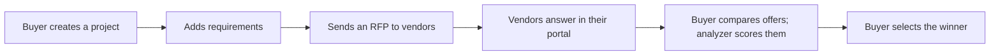
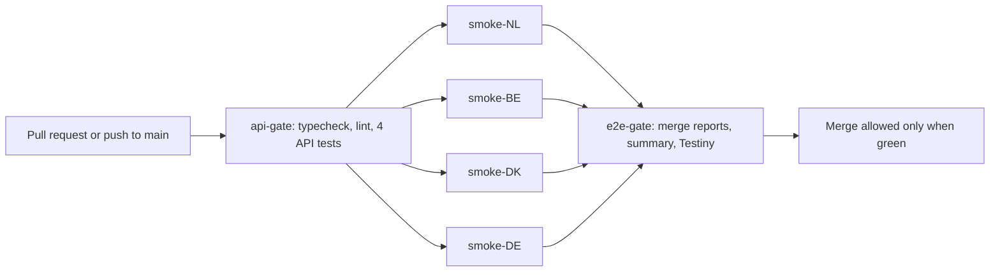
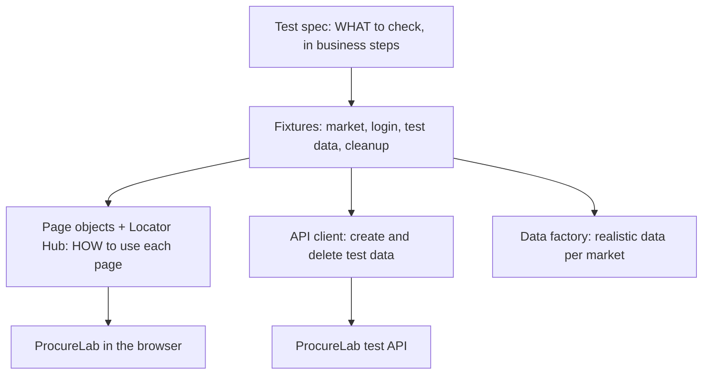

# ProcureLab: an agentic test automation platform you can try yourself

[](https://github.com/bikashdehury919/procurelab/actions/workflows/e2e.yml)
[](https://github.com/bikashdehury919/procurelab/actions/workflows/e2e-nightly.yml)

This repository holds two things that belong together:

1. **ProcureLab**, a small web application for buying IT services: a company asks vendors for offers, compares them and picks a winner. It runs in 4 markets (Netherlands, Belgium, Denmark, Germany) and 4 languages, with 3 user roles. All companies, people and data are fictional.
2. **A test automation platform** in `e2e/` that checks ProcureLab on every change, in all 4 markets, before anything can be merged. It is built with Playwright and TypeScript, reports to GitHub and Testiny, and works with Claude Code as an AI assistant that writes, repairs and explores tests under clear rules.

The goal is simple: **teams can move fast, and still know that what they ship works.**

---

## Who should read what

| You are... | Start with | Time |
|---|---|---|
| A **manager** or product owner | [Testing strategy](#3-testing-strategy), [What is tested today](#4-what-is-tested-today), [How the pipeline protects main](#7-the-cicd-pipeline) | 10 min |
| A **manual tester** | [Try it in 5 minutes](#1-try-it-in-5-minutes), [The application](#2-the-application-in-2-minutes), [Exploratory testing](#6-exploratory-testing), [Run the tests yourself](#5-run-the-tests-yourself) | 30 min |
| A **developer or automation engineer** | [Run the tests yourself](#5-run-the-tests-yourself), [Framework architecture](#9-framework-architecture), [Write a new test](#10-write-a-new-test), [AI-assisted testing](#11-ai-assisted-testing-with-claude-code) | 45 min |

---

## Contents

1. [Try it in 5 minutes](#1-try-it-in-5-minutes)
2. [The application in 2 minutes](#2-the-application-in-2-minutes)
3. [Testing strategy](#3-testing-strategy)
4. [What is tested today](#4-what-is-tested-today)
5. [Run the tests yourself](#5-run-the-tests-yourself)
6. [Exploratory testing](#6-exploratory-testing)
7. [The CI/CD pipeline](#7-the-cicd-pipeline)
8. [Test management with Testiny](#8-test-management-with-testiny)
9. [Framework architecture](#9-framework-architecture)
10. [Write a new test](#10-write-a-new-test)
11. [AI-assisted testing with Claude Code](#11-ai-assisted-testing-with-claude-code)
12. [Configuration and secrets](#12-configuration-and-secrets)
13. [Troubleshooting](#13-troubleshooting)
14. [Reference: the application](#14-reference-the-application)

---

## 1. Try it in 5 minutes

### What you need

| Tool | Version | Check with |
|---|---|---|
| [Node.js](https://nodejs.org) | 20 or newer (22 LTS recommended) | `node -v` |
| [Git](https://git-scm.com) | any recent version | `git --version` |
| A browser | Chrome, Edge, Firefox or Safari | |

### Start the application

```bash
git clone https://github.com/bikashdehury919/procurelab.git
cd procurelab
npm install
npm start
```

Open **http://localhost:3000** and sign in. Every demo account uses the password **`Demo123!`**.

| Sign in as | To see |
|---|---|
| `buyer@procurelab.test` | The procurement manager: dashboard, projects, vendors, RFPs, offer comparison |
| `vendor.nl@procurelab.test` | The vendor portal: invitations, questions, sending an offer |
| `admin@procurelab.test` | Everything, plus user administration and the data page |
| `locked@procurelab.test` | A deactivated account: the sign-in is refused |

The first start creates a `data/` folder with demo data. To start fresh at any time: stop the app (Ctrl+C) and run `npm run reset-data`, or use **Data > Reset demo data** as admin.

---

## 2. The application in 2 minutes

### The business flow



An **RFP** (request for proposal) is the buyer's question to vendors: "what would you charge, and how fast can you deliver?" Each vendor answers with an offer (a proposal), and the buyer picks one.

### Three roles

| Role | Can do | Cannot do |
|---|---|---|
| Administrator | Everything, plus users and data | |
| Procurement manager (buyer) | Projects, vendors, RFPs, comparison, analyzer | User administration |
| Vendor | Their own invitations, questions, offers | See other vendors' offers or documents, open buyer pages |

### Four markets

| Market | Default language | Currency | VAT | VAT breakdown | AI analyzer | Vendor questions |
|---|---|---|---|---|---|---|
| Netherlands (NL) | Dutch | EUR | 21% | on | on | on |
| Belgium (BE) | Dutch | EUR | 21% | off | off | on |
| Denmark (DK) | Danish | DKK | 25% | on | on | off |
| Germany (DE) | German | EUR | 19% | on | off | off |

The last three columns are **feature flags**: switches that turn a feature on in one market and off in another, like a real product rolling out country by country. Any of the 4 languages (English, Dutch, Danish, German) works in any market.

**Why this makes a good test target:** roles that must not see each other's data, money and VAT per country, translations, file uploads, feature flags, and a business flow over several steps and two roles. These are the things that make testing hard in real products.

---

## 3. Testing strategy

### The goal

Every change is checked quickly and in the same way, in all 4 markets, **before** it can reach the main branch. Slower and more creative testing happens beside the pipeline, not in front of it, so it never slows developers down.

### Four principles

1. **Only fast, reliable checks may block a merge.** Like airport security: quick, the same for everyone, and nobody skips it.
2. **AI proposes, people approve.** AI can write, repair and explore tests, but its work arrives as a pull request and passes the same gate as human work.
3. **Tests live next to the code.** The pull request that changes the app also runs, and if needed fixes, its own tests.
4. **Testiny is the shared notebook.** Testers write cases and charters there, and every automated run reports back there.

### The testing layers

| Layer | What it answers | When it runs | Blocks a merge? | Owner |
|---|---|---|---|---|
| **API checks** (4 tests) | Is the system up and configured correctly? | Every pull request, first | Yes | Platform |
| **Smoke** (8 scenarios x 4 markets) | Can a user do the most important things in every market? | Every pull request | Yes | Platform |
| **Regression** (16 tests) | Do the detailed rules still hold: validation, permissions, multi-role flows? | Every weekday night | No: report and Testiny | Platform and teams |
| **Exploratory** (8 charters) | What problems has nobody written down yet? | Per feature or release, by testers (optionally assisted by AI) | No | Testers |
| **AI-assisted** | New tests from cases, repaired locators, exploration at scale | On request, as pull requests | Through the same gate | People approve |

A **smoke test** is like starting a car before a long trip: engine, lights, brakes. A **regression test** checks that something that worked before still works after a change.

### Policies

- **Known bugs are tracked, not hidden.** A test for a real, open bug is marked "expected to fail" with a ticket reference. The pipeline stays green, and the day someone fixes the bug, the test tells us to remove the marker. Example: REG-I18N-02.
- **Flaky tests are not tolerated.** A failed test runs once more in CI; if it then passes, it is reported as flaky, not hidden, and gets a ticket.
- **Every test creates its own data and deletes it afterwards**, even when it fails. Shared demo data is only read. Names carry a run tag, so parallel runs never collide.
- **Expected values come from the system, not from guesses.** VAT, currency and feature flags are read from the app's configuration.
- **Healing finds elements; it never changes what a test checks.** See [the Locator Hub](#self-healing-with-the-locator-hub).

### Where results live

| Where | What you see | Best for |
|---|---|---|
| The pull request page | Green or red checks per job | Developers: can I merge? |
| The run's summary page in GitHub Actions | A table of passed, failed and flaky tests per market | Everyone: what happened? |
| The HTML report on GitHub Pages | Every test, step, screenshot, video and trace | Engineers: why did it fail? |
| Testiny | One run per pipeline, results per test and market, history | Testers and managers: coverage and trends |

### What we measure

| Measure | Target |
|---|---|
| Time a developer waits for the pull request result | under 10 minutes |
| Flaky test rate | under 2% |
| Bugs that reach customers, per market | going down |
| Share of written test cases that are automated | going up (today: 28 of 48) |

---

## 4. What is tested today

### Coverage by area (Testiny functional cases)

| Area | Test cases | Automated | Still to automate |
|---|---|---|---|
| Smoke | 8 | 8 (in all 4 markets) | 0 |
| API | 4 | 4 | 0 |
| Projects | 8 | 6 | 2 |
| RFPs | 6 | 3 | 3 |
| Vendor portal | 6 | 3 | 3 |
| Vendors | 5 | 0 | 5 |
| Administration | 5 | 2 | 3 |
| Markets and languages | 3 | 2 (one is a known defect) | 1 |
| AI Proposal Analyzer | 3 | 0 | 3 (one needs an LLM judge) |
| **Total** | **48** | **28** | **20** |

Plus **8 exploratory charters**, which are run by people, not automated.

### The automated scenarios

**Smoke: every pull request, in NL, BE, DK and DE**

| ID | What it checks |
|---|---|
| SMK-01 | A buyer signs in through the login page, in the market's language |
| SMK-02 | The dashboard shows its 4 KPIs, recent activity and the right market settings |
| SMK-03 | The projects list shows the market's own projects |
| SMK-04 | The vendor directory filters by expertise |
| SMK-05 | A project can be created from start to finish |
| SMK-06 | Offer prices show the market's currency and VAT |
| SMK-07 | The language can be switched to English in every market |
| SMK-08 | A vendor sees an open RFP with its requirements and documents |

**API: every pull request, first**

| ID | What it checks |
|---|---|
| API-01 | The health endpoint answers |
| API-02 | The configuration lists all 4 markets with the right VAT and currency |
| API-03 | The test data API refuses requests without a token |
| API-04 | A project can be created and deleted through the API, with local data |

**Regression: every weekday night**

| ID | What it checks |
|---|---|
| REG-PRJ-01 | Mandatory project fields are validated |
| REG-PRJ-02 | An end date before the start date is refused |
| REG-PRJ-03 | Duplicate project names are refused within a market |
| REG-PRJ-04 | Project search and status filter |
| REG-PRJ-05 | Archiving hides a project; restoring brings it back |
| REG-PRJ-06 | An RFP needs at least one requirement |
| REG-RFP-01 | An RFP is sent with an attachment |
| REG-RFP-02 | Forbidden file types are refused |
| REG-RFP-03 | Full flow over two roles: vendor answers, buyer compares, analyzer scores, buyer selects |
| REG-VND-01 | A second offer for the same RFP is refused, also by the server |
| REG-VND-02 | A closed RFP no longer accepts offers |
| REG-VND-03 | Vendors cannot open RFPs they are not invited to, or buyer pages |
| REG-ADM-01 | An admin creates a user who can sign in; deactivation signs them out |
| REG-ADM-02 | Procurement managers cannot open user administration |
| REG-I18N-01 | Every language defines every text |
| REG-I18N-02 | The German RFP form is fully translated (**known defect**: the "Send RFP" button is still English) |

---

## 5. Run the tests yourself

You need the app running in one terminal and the tests in a second one.

### One-time setup

```bash
# Terminal 1: the app
cd procurelab
npm install
npm start
```

```bash
# Terminal 2: the tests
cd procurelab/e2e
npm ci
npx playwright install chromium
```

### Run

| Command (in `e2e/`) | What runs | Tests |
|---|---|---|
| `npm run test:smoke` | Smoke in all 4 markets, plus the API checks | 42 (incl. 6 sign-ins) |
| `npm run test:regression` | The regression suite | 22 (incl. 6 sign-ins) |
| `npm run test:api` | API checks only, no browser | 4 |
| `npm test` | Everything | 58 |
| `npx playwright test --project=smoke-DK` | Smoke in one market | 14 |
| `npx playwright test -g "SMK-05"` | One scenario, by its ID | |

**The "sign-ins" are not tests of their own.** Before the browser tests start, each role signs in once through the API and the session is reused, which makes the suite much faster. The login page itself is tested by SMK-01.

### Watch it and read the results

| Command | What you get |
|---|---|
| `npx playwright test -g "SMK-05" --headed` | A real browser window doing the steps |
| `npx playwright test --ui` | UI mode: click a test, see every step with a screenshot. The best way to learn |
| `npm run report` | The HTML report of the last run |

**When a test fails,** open the report, click the failed test and open its **trace**. You can replay every step, see the page at that moment, and see the network calls. That is usually enough to tell whether the app, the test or the test data is wrong.

### Checks before you propose a change

```bash
npm run check        # typecheck + lint + formatting + list all tests
```

---

## 6. Exploratory testing

Automated tests check what we already know. **Exploratory testing finds what nobody wrote down.** A tester follows a short mission, a **charter**, for a fixed time, and writes down what they find.

### The charters (in Testiny, folder "03 Exploratory charters")

| ID | Mission |
|---|---|
| EXP-01 | RFP creation with unusual inputs, to discover validation gaps |
| EXP-02 | The vendor offer flow as a hurried vendor, to discover usability and data problems |
| EXP-03 | Market and language switching, to discover formatting and translation issues |
| EXP-04 | Role boundaries, to discover access-control weaknesses |
| EXP-05 | The AI Proposal Analyzer with edge-case offers, to discover misleading results |
| EXP-06 | Data persistence, to discover consistency problems |
| EXP-07 | The vendor directory with many vendors, to discover search and filter issues |
| EXP-08 | Keyboard-only and screen-reader use, to discover accessibility barriers |

### Run a session yourself (30 minutes)

1. Pick a charter and set a timer.
2. Sign in, and use `?market=` and `?lang=` in the address bar to switch quickly, for example `http://localhost:3000/dashboard?market=DK&lang=en`.
3. Note what you tried, what you saw, and every problem: steps, expected versus actual, market and language, a screenshot.
4. Log the session in Testiny as a test run with your notes.

**Try this one:** run **EXP-03** and compare the **New RFP** form in all 4 languages. There is one real, intentional bug to find. (Answer: the German "Send RFP" button is not translated. An automated test, REG-I18N-02, already tracks it as a known defect.)

**Useful extras for testers:**
- **Switch a feature on or off for your own session only:** add `?ff_vatBreakdown=on` (or `off`), `?ff_aiAnalyzer=...` or `?ff_vendorQuestions=...` to the URL. `?ff_reset=1` clears all overrides.
- **See every translation and any missing text:** open http://localhost:3000/api/i18n.

---

## 7. The CI/CD pipeline

Every pull request, and every push to `main`, runs the **E2E** workflow in GitHub Actions:



| Job | What it does |
|---|---|
| **api-gate** | Installs, checks types and code rules, starts the app inside the CI machine, runs the 4 API tests. Fails fast, before any browser starts |
| **smoke-NL / BE / DK / DE** | Four jobs at the same time, one per market, each on a fresh machine. Like four checkout lanes open instead of one |
| **e2e-gate** | Merges the four reports into one, writes the summary, uploads to Testiny, publishes the HTML report (on `main`), and fails if any test failed |

**The gate cannot be bypassed.** `main` is protected: a change needs a pull request and a green **e2e-gate**, for everyone, admins included.

**Nightly:** the **E2E nightly regression** workflow runs the 16 regression tests at 02:00 UTC, Monday to Friday, split over 4 machines. It publishes its own report and Testiny run. You can also start it by hand: Actions > E2E nightly regression > Run workflow.

**Reading a failed run:** open the run, read the summary table, then open the HTML report link and the failed test's trace. If the app did not start, download the `app-log-<market>` artifact.

---

## 8. Test management with Testiny

[Testiny](https://www.testiny.io) holds the test cases written by people, and receives the results of every automated run.

| In Testiny | Comes from |
|---|---|
| 48 functional cases in folders (01 Smoke, 02 Regression/...) | `e2e/docs/testiny/procurelab-functional-testcases.csv` |
| 8 exploratory charters | `e2e/docs/testiny/procurelab-exploratory-charters.csv` |
| Automation runs, one per pipeline | Uploaded by the e2e-gate and the nightly workflow |

**How a result finds its case:** every automated test has an ID (`SMK-02`), and the platform adds the market, so Testiny receives keys like `SMK-02-DK`. The same test in the same market is recognised across runs, which gives a history per market.

**Upload from your laptop** (optional): create `e2e/.env` with your own key, then:

```bash
cd e2e
cp .env.example .env          # set TESTINY_API_KEY and TESTINY_PROJECT
npm run test:smoke
npm run testiny:upload -- --suite smoke
```

Without a key, the upload is skipped cleanly and never breaks a build.

---

## 9. Framework architecture

### How a test is built



A test reads like business steps, because the layers below hide the technical detail:

```typescript
test('SMK-08 vendor sees an open RFP with requirements and documents',
  { annotation: { type: 'id', description: 'SMK-08' } },
  async ({ portalPage, seeded }) => {
    await portalPage.goto();
    await expect(await portalPage.companyName()).toHaveText(seeded.vendorCompany);
    await portalPage.openRfp(seeded.vendorOpenRfp);
    await expect(portalPage.requirements.first()).toBeVisible();
    await expect(portalPage.documents.first()).toBeVisible();
  });
```

There is no address, market or login in the test. The environment profile gives the address, the Playwright project gives the market, and a sign-in that ran once before the tests gives the session. If the vendor portal's layout changes, one page object changes, not dozens of tests.

### Folder structure

```
procurelab/
  server.js, src/, public/        The application
  CLAUDE.md                       Rules Claude Code follows in this repo
  .claude/skills/                 Repeatable AI workflows (see section 11)
  .github/workflows/              e2e.yml (pull requests) and e2e-nightly.yml
  e2e/
    playwright.config.ts          Projects: setup, smoke-NL/BE/DK/DE, regression, api
    config/env/                   .env.local / .env.ci / .env.render: settings per environment, no secrets
    test-data/<env>/              Expected reference data per environment (seeded names, accounts)
    test-data/files/              Files for upload tests
    src/config/                   Loads the environment; checks the app is up before any test
    src/api/                      Client for the app's test data API
    src/data/                     Data factory: realistic data per market (Faker)
    src/pages/                    Page objects, one per screen
    src/locators/                 Locator Hub with logged self-healing
    src/fixtures/                 What every test gets: market, page objects, data, cleanup
    tests/smoke/                  The release gate, per market
    tests/regression/             Detailed rules and multi-role flows
    tests/api/                    Fast checks without a browser
    utils/                        Summary, Testiny upload, healing report
    docs/testiny/                 The test cases and charters as CSV
```

### Key design choices

| Choice | Why |
|---|---|
| `data-testid` on every element | Tests do not break when text, language or layout changes |
| Market as a Playwright project | One test runs in 4 markets without a single extra line |
| Test data through the API, behaviour through the UI | Setup takes milliseconds and cannot fail for unrelated UI reasons |
| Automatic cleanup in fixtures | Tests never leave data behind, even when they fail |
| Environment profiles + secrets only in `.env` or CI secrets | The same tests run locally, in CI and against a deployed site |
| Expected values from `/api/config` | VAT, currency and flags are never hard-coded |

### Self-healing with the Locator Hub

The most important element locators live in one registry, `e2e/src/locators/hub.ts`. Each entry has a primary way to find the element (its `data-testid`) and a few fallbacks.

- **At runtime,** if the primary finds nothing, the hub tries the fallbacks. It accepts one only if it matches exactly **one** element. Every heal is logged as a test annotation, an attachment in the report and a line in `reports/healing.jsonl`. No AI is involved at this point.
- **Afterwards,** `npm run healing:report` lists the heals, and Claude Code's `heal-locators` skill turns them into a permanent, reviewed fix of `hub.ts`.
- **Strict mode:** `HEALING=off npx playwright test ...` disables fallbacks, so the primary must work.

**Try it:** rename `data-testid="vendor-company"` to `data-testid="vendor-company-name"` in `src/views/vendor.js` and restart the app. Then, in `e2e/`, run `npx playwright test --project=smoke-NL -g "SMK-08"` and `npm run healing:report`. The test passes and shows the heal; with `HEALING=off` it fails. Undo the rename afterwards with `git checkout -- src/views/vendor.js`.

---

## 10. Write a new test

1. **Write or pick the case** in Testiny, and give it an ID (for example `VEN-03`).
2. **Find the elements:** every element you need must have a `data-testid`. If one is missing, that is an app change: ask the developer.
3. **Reuse the page object** in `e2e/src/pages/`. Add a method only if it is missing, and keep locators in the page object, never in the test.
4. **Write the test** in `tests/smoke/` or `tests/regression/`, importing `test` and `expect` from `src/fixtures/test`:
   ```typescript
   import { test, expect } from '../../src/fixtures/test';
   import { authFile } from '../../src/config/markets';

   test.use({ storageState: authFile('buyer') });

   // Example only: EX-01 is not a Testiny case. Real tests use the case's own ID.
   test('EX-01 a vendor created through the API can be found by name', { tag: '@regression', annotation: { type: 'id', description: 'EX-01' } },
     async ({ seed, vendorsPage }) => {
       const vendor = await seed.vendor();               // created through the API, deleted afterwards
       await vendorsPage.goto();
       await vendorsPage.filter({ q: vendor.name });
       await expect(vendorsPage.links).toHaveText([vendor.name]);
     });
   ```
5. **Prove it is stable:** `npx playwright test -g "EX-01" --repeat-each=3`, then `npm run check`.
6. **Open a pull request.** The gate runs; a person reviews.

The full rule list is in [`CLAUDE.md`](CLAUDE.md). The short version: one ID per test, no waiting with fixed sleeps, no hard-coded names, and never weaken an assertion to make a test pass.

---

## 11. AI-assisted testing with Claude Code

[Claude Code](https://docs.claude.com/en/docs/claude-code/overview) works in this repository under the rules in `CLAUDE.md`, and with repeatable workflows called **skills** in `.claude/skills/`.

| Skill | What Claude does | Guardrail |
|---|---|---|
| `new-e2e-test` | Reads a test case (from Testiny or as text), looks at the real page, writes the test with the existing page objects, runs it 3 times | Pull request and the e2e-gate; a person reviews |
| `heal-locators` | Confirms each logged heal on the real page and updates the Locator Hub, then proves it in strict mode | Only `hub.ts` changes; assertions are off-limits |
| `explore-charter` | Runs a charter as a time-boxed session in several markets and languages, saves evidence, logs the session in Testiny | The tester owns the charter and decides what is a bug |
| `playwright-cli` | Lets Claude open the app, take a snapshot and see the real `data-testid`s instead of guessing | Runs locally with `npx playwright-cli` from `e2e/` |

**Example prompts** (start `claude` in the repo root):

> Use the new-e2e-test skill. Automate Testiny case VEN-01 (add a vendor with valid data) in e2e/tests/regression/vendors.spec.ts. Explore the page with playwright-cli first. Run it with --repeat-each=3 and npm run check. Do not change other tests.

> Use the explore-charter skill. Run charter EXP-03 with a 10-minute time-box in markets DE and DK.

**Optional: Testiny for Claude.** With the [Testiny MCP server](https://www.testiny.io/docs/mcp-server), Claude can read cases and write session results directly in Testiny. Use a dedicated, revocable API key, and never add it with `--scope project`, which would write the key into the repository. Without it, the same skills work from the CSV files in `e2e/docs/testiny/`.

**The line we never cross:** AI may propose tests, fixes and findings. It may not decide on its own that a release goes live, and it may not change what a test expects.

---

## 12. Configuration and secrets

| Where | What | In Git? |
|---|---|---|
| `e2e/config/env/.env.local`, `.env.ci`, `.env.render` | Settings per environment: app address, local test token | Yes (no secrets) |
| `e2e/.env` | Your own secrets for local runs, for example the Testiny key | **No** (ignored) |
| GitHub > Settings > Secrets and variables > Actions | `TESTINY_API_KEY` (secret), `TESTINY_PROJECT` (variable) | No |
| `.env` in the repo root | Optional app settings, see `.env.example` | **No** (ignored) |

Choose the environment with `TEST_ENV`: `local` (default), `ci` or `render`. Never put a key in a file that Git tracks.

---

## 13. Troubleshooting

| Problem | Fix |
|---|---|
| `global-setup: ProcureLab not reachable` | Start the app in the repo root with `npm start` |
| `Cannot find module 'express'` | Run `npm install` in the repo root |
| `Missing script: "typecheck"` | You are in the repo root: `cd e2e` first |
| `Executable doesn't exist` (browser) | `npx playwright install chromium` in `e2e/` |
| Seeded names not found | Demo data was changed by hand: stop the app, `npm run reset-data`, start again |
| Port 3000 is in use | Another copy of the app is running: close that terminal |
| Testiny upload says "skipped" | `e2e/.env` must contain `TESTINY_API_KEY` and `TESTINY_PROJECT`, and sit directly in `e2e/` |
| A test fails only in CI | Open the run's HTML report and trace; download `app-log-<market>` if the app did not start |

---

## 14. Reference: the application

### Accounts

All demo accounts use the password `Demo123!`.

| Email | Role | Notes |
|---|---|---|
| admin@procurelab.test | Administrator | Everything a procurement manager can do, plus Users and Data |
| buyer@procurelab.test | Procurement manager | Dashboard, projects, vendors, RFPs, comparison |
| vendor.nl@ / vendor.be@ / vendor.dk@ / vendor.de@procurelab.test | Vendor | Vendor portal only, locked to its own company and market |
| locked@procurelab.test | Procurement manager (deactivated) | Login is refused with a "deactivated" message |

### Features

| Area | What you can do | Good test scenarios |
|---|---|---|
| Dashboard | KPI cards (projects, active RFPs, proposals, vendors) and recent activity per market | KPIs match `/api`, activity appears after an action, role permissions |
| Projects | Create, edit, archive and restore, search, filter by status | Mandatory fields, end date before start date, duplicate name per market |
| Requirements | Add and remove requirements with Must, Should or Could priority | An RFP is blocked until the project has a requirement |
| Vendors | Add, remove, search, filter by expertise and minimum rating, view details, assign to a project | Validation, assignment shows on the project |
| RFPs | Choose requirements, invite vendors, set a deadline, upload attachments | Upload type and size limits, invitation count |
| Vendor portal | My RFPs, requirements, document download, questions, proposal with price, delivery and documents | Multi-role flow, duplicate proposal (409), closed RFP, not-invited RFP (404) |
| Comparison | Sort, filter by rating, open a proposal, compare 2 or 3 side by side, select or reject | Selecting one marks the others "not selected" |
| AI Proposal Analyzer | Score, risk level and missing-information flags; optional LLM summary | Exact scores, recommended badge, missing document raises risk |
| Users (admin) | Create admin, procurement or vendor users; activate and deactivate | User is saved to `users.json`, a deactivated user is signed out immediately |
| Data (admin) | See JSON files and record counts, download a JSON export, reset demo data | Counts change after actions; the export contains no password hashes |

**Downloads are permission-checked.** A vendor can download documents of RFPs they are invited to and their own proposal files, never a competitor's.

### Where data is stored

| Path | Contents |
|---|---|
| `data/users.json` | Users. Passwords are scrypt-hashed and never stored in plain text |
| `data/vendors.json`, `projects.json`, `requirements.json`, `rfps.json`, `proposals.json`, `questions.json`, `activity.json` | One JSON file per collection |
| `data/files.json` | Metadata for every uploaded file: name, size, owner, uploaded by |
| `data/uploads/` | The uploaded files themselves |
| `data/meta.json` | ID counters and the last-saved time |

Every change is written immediately and atomically (a temp file, then a rename), so restarting the app keeps all data. Set `DATA_DIR` to store data elsewhere.

### Test hooks

- **Deep links:** `?market=DK` and `?lang=en`. Vendor users ignore `?market`.
- **Feature flags per session:** `?ff_vatBreakdown=on|off`, `?ff_aiAnalyzer=on|off`, `?ff_vendorQuestions=on|off`; `?ff_reset=1` clears all overrides.
- **Stable selectors:** every interactive and asserted element has a `data-testid`. `<body>` also exposes `data-market`, `data-lang`, `data-locale` and `data-role`.
- **Formatting locale:** number and date formatting combines the UI language with the market: `en-DK` means English text with Danish currency and dates.
- **Seeded data:** each market has an open RFP where its vendor login is invited but has not answered yet, and a closed RFP. The NL "Cloud Migration RFP" has 3 proposals; DigitalWorks has no document, so the analyzer flags it.
- **Intentional defect:** the German "Send RFP" button is left in English.

### Test data API

`/api/health`, `/api/config` and `/api/i18n` are public. Everything else requires the header `x-test-token: $TEST_API_TOKEN` (locally: `local-test-token`).

| Method | Path | Notes |
|---|---|---|
| POST | /api/test/reset | Restore demo data |
| GET | /api/stats | Data files, record counts, upload size |
| GET / POST / DELETE | /api/users | POST takes `{name, email, role, market, vendorId?, password}` |
| GET / POST / DELETE | /api/projects | POST takes `{market, name, owner, budget, startDate, endDate, ...}`. DELETE cascades to RFPs, proposals and files |
| POST | /api/projects/:id/requirements | `{name, priority}` |
| GET / POST / DELETE | /api/vendors | POST takes `{market, name, city, contact, expertise[], rating, ...}` |
| POST | /api/projects/:id/rfps | `{title, requirementIds[], vendorIds[], deadline}`. Past deadlines are allowed, for closed-RFP tests |
| POST | /api/rfps/:id/files | multipart, field `files` |
| GET | /api/rfps/:id | RFP with state, proposals, questions and files |
| POST | /api/rfps/:id/proposals | `{vendorId, priceNet, deliveryMonths, note?}` |

### App scripts (repo root)

| Command | What it does |
|---|---|
| `npm start` | Start the app on http://localhost:3000 |
| `npm run dev` | Start with automatic restart on code changes |
| `npm run reset-data` | Restore the demo data (stop the app first) |

### Configuration

See `.env.example` for all variables: `PORT`, `APP_NAME`, `DATA_DIR`, `MAX_UPLOAD_MB`, `DEMO_PASSWORD`, `TEST_API_TOKEN`, `DEFAULT_MARKET`, `ALLOW_FLAG_OVERRIDES`, and the optional `ANTHROPIC_API_KEY` for the AI summary.

### Known limits

ProcureLab is a demo application. It runs as a single process with JSON files and no database. There is no CSRF protection, no email delivery and no password reset flow. Uploads are checked by file extension and size, not scanned for viruses.

---

*All companies, people and data in this repository are fictional.*
